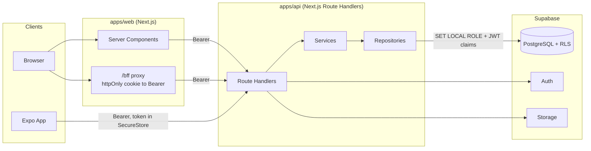
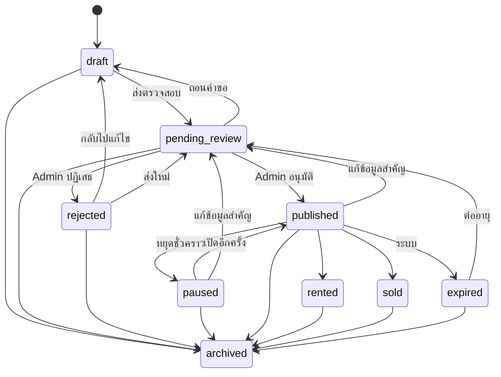

# Architecture

เอกสารนี้สรุป Requirements, Assumptions และการตัดสินใจเชิงสถาปัตยกรรม อ่านคู่กับ
[database-schema.md](database-schema.md), [api-documentation.md](api-documentation.md) และ [security.md](security.md)

## 1. สรุป Requirements

ตลาดอสังหาริมทรัพย์สำหรับประเทศไทย รองรับซื้อ ขาย เช่า (คอนโด อพาร์ตเมนต์ ห้องรายเดือน ห้องรายวันที่เปิดปิดได้)
มี 3 ระบบ คือ Web (Next.js), Mobile (Expo) และ Backend API (Next.js Route Handlers) บน Supabase
ผู้ใช้ 4 ระดับ คือ Guest, Member, Owner/Agent และ Admin

## 2. Assumptions

| # | สมมติฐาน | เหตุผล |
|---|---|---|
| A1 | โปรเจกต์ใหม่ (repo มีแค่ `package.json` เปล่า) | ตรวจสอบแล้ว |
| A2 | ไม่มีการชำระเงินออนไลน์ เงินจองและเงินประกันเป็นข้อมูลแสดงผล | ไม่อยู่ใน Requirements |
| A3 | ราคาเก็บเป็นบาทเต็ม (`bigint`) ไม่มีสตางค์ | ราคาอสังหาในไทยไม่ใช้สตางค์ และเลี่ยงปัญหาทศนิยม |
| A4 | สมาชิกเลื่อนเป็น Owner/Agent ได้เอง แต่ทุกประกาศต้องผ่าน Admin | ลดแรงเสียดทาน โดยยังมีการตรวจสอบก่อนเผยแพร่ |
| A5 | ประกาศหมดอายุหลัง 90 วัน (ปรับได้ใน `application_settings`) | ค่าเริ่มต้นทั่วไปของตลาด |
| A6 | ห้องรายวันปิดเป็นค่าเริ่มต้น | เช่ารายวันมีข้อกฎหมายโรงแรมที่เจ้าของระบบควรตัดสินใจเอง |
| A7 | ข้อมูลพื้นที่ใช้ชุดข้อมูลเปิด kongvut/thai-province-data (MIT) ไม่ใช่แหล่งราชการโดยตรง | ครบทุกตำบลและมีรหัสไปรษณีย์ ควรสุ่มตรวจก่อนเปิดใช้งาน |
| A8 | แผนที่บน Web ใช้ Leaflet + OpenStreetMap, Mobile เปิดแอปแผนที่ของเครื่อง | ไม่ต้องมี API Key |

## 3. ภาพรวมระบบ



## 4. การตัดสินใจหลัก

### 4.1 API เป็นทางเข้าข้อมูลเพียงทางเดียว

Web และ Mobile เรียก `/api/v1` ชุดเดียวกัน Client ไม่ถือ Supabase key เลย ทำให้ไม่มีทางเปิดเผย Service Role Key
และ Business Rule อยู่ที่เดียว

### 4.2 API ต่อ PostgreSQL ตรง และยังบังคับ RLS

API ใช้ไลบรารี `postgres` ต่อผ่าน Supavisor (transaction mode) แทน supabase-js เพราะต้องการ Transaction จริง
เช่น เปลี่ยนสถานะพร้อมเขียน Audit Log ให้สำเร็จหรือล้มเหลวพร้อมกัน

ทุกคำขอรันในหนึ่งใน 3 บริบท

| บริบท | ทำอะไร | ใช้เมื่อ |
|---|---|---|
| `withAnon` | `SET LOCAL ROLE anon` | อ่านข้อมูลสาธารณะ |
| `withUser` | `SET LOCAL ROLE authenticated` + `request.jwt.claims` | งานของผู้ใช้ทุกอย่าง |
| `withService` | `SET LOCAL ROLE service_role` | งาน Admin และงานระบบ หลังตรวจสิทธิ์ใน API แล้ว |

ผลคือ RLS ทำงานจริงกับคำขอของผู้ใช้ เป็นปราการชั้นที่สองถ้าโค้ด API พลาด (ลด IDOR)
และ Policy ที่ทดสอบคือ Policy เดียวกับที่ใช้จริง

### 4.3 Authentication

- Supabase Auth เป็นผู้ออกและยืนยันตัวตน API เป็นตัวกลางทุกการเรียก (`/auth/*`)
- API ตรวจ JWT ด้วย JWKS (หรือ `SUPABASE_JWT_SECRET` สำหรับโปรเจกต์ HS256 แบบเก่า) แล้วโหลดสถานะและ Role จากฐานข้อมูลทุกคำขอ
  การระงับผู้ใช้หรือถอน Role จึงมีผลทันที ไม่ต้องรอ Token หมดอายุ และ Role ไม่ได้มาจาก Client
- **Web:** Token อยู่ใน Cookie แบบ `httpOnly; SameSite=Lax; Secure` JavaScript อ่านไม่ได้ เบราว์เซอร์เรียก `/bff/*`
  ซึ่งแปลง Cookie เป็น Bearer และ Refresh ให้อัตโนมัติ คำขอที่เปลี่ยนข้อมูลต้องผ่านการตรวจ `Origin` (กัน CSRF)
- **Mobile:** Token อยู่ใน Expo SecureStore ส่ง Bearer ตรง เมื่อได้ 401 จะเรียก `/auth/refresh` แล้วลองใหม่หนึ่งครั้ง
  การ Refresh พร้อมกันหลายคำขอถูกรวมเป็นครั้งเดียว เพราะ Refresh Token ใช้ซ้ำไม่ได้

### 4.4 โมเดลข้อมูล โครงการ อาคาร ห้อง ประกาศ

`properties` (โครงการหรืออาคาร ซ้อนกันด้วย `parent_id`) → `property_units` (ห้อง) → `listings` (ประกาศ)
ห้องหนึ่งมีได้ทั้งประกาศขายและประกาศเช่า แต่มีประกาศที่ยังใช้งานได้เพียงหนึ่งรายการต่อวัตถุประสงค์
บังคับด้วย Partial Unique Index

### 4.5 สถานะประกาศ



กฎนี้นิยามสองที่โดยตั้งใจ คือ `packages/shared` (ให้ UI และ Service ใช้) และ Trigger ในฐานข้อมูล (ด่านสุดท้าย)
มี Test เทียบสองชุดนี้ให้ตรงกันเสมอ

### 4.6 การค้นหา

- `pg_trgm` + GIN บนคอลัมน์ `listings.search_text` ภาษาไทยไม่มีช่องว่างระหว่างคำ `tsvector` จึงตัดคำไม่ได้
  ทดสอบกับ PostgreSQL จริงแล้วว่า `ILIKE '%เชียงใหม่%'` ใช้ Index
- ใช้ **Cursor Pagination** (keyset) สำหรับการค้นหา เพื่อความเร็วคงที่แม้เลื่อนลึก
- ค้นหาตามแผนที่ใช้ Bounding Box บน `lat/lng` ซึ่งมี B-tree Index ยังไม่ใช้ PostGIS เพราะ Requirements ระบุว่าใช้
  "เมื่อจำเป็น" และโจทย์ปัจจุบันคือการกรองตามกรอบแผนที่เท่านั้น ถ้าต้องการหาตามรัศมีในข้อมูลขนาดใหญ่ค่อยเพิ่ม Migration

### 4.7 รูปภาพ

อัปโหลดผ่าน API แบบ multipart จากนั้น `sharp` จะถอดรหัสไฟล์จริงและเข้ารหัสใหม่เป็น WebP พร้อม Thumbnail
ข้อดีคือพิสูจน์ได้ว่าเป็นรูปจริงโดยไม่เชื่อ MIME Type จาก Client และลบ EXIF ที่อาจมีพิกัด GPS ของผู้ใช้ไปด้วย
จำกัดไฟล์ละ 4 MB เพราะ Serverless Platform ส่วนใหญ่จำกัด Body ประมาณ 4.5 MB

### 4.8 Realtime

ข้อความใช้ Polling ผ่าน TanStack Query (ทุก 5 วินาทีเมื่อเปิดบทสนทนาอยู่) เพราะ Web ไม่เปิดเผย Token ให้ JavaScript
จึงต่อ Supabase Realtime ตรงไม่ได้ เส้นทางอัปเกรดคือเพิ่ม SSE ใน API โดยไม่ต้องแก้ Schema

### 4.9 Rate Limiting

ใช้ตารางและฟังก์ชันใน PostgreSQL (`rate_limit_hit`) แทน Redis เพื่อไม่เพิ่มบริการใหม่ และทำงานถูกต้องบน Serverless หลาย Instance

## 5. Project Structure

```
apps/
  api/        Next.js Route Handlers  (src/app/api/v1, src/modules, src/lib)
  web/        Next.js                 (src/app, src/components, src/features, src/lib)
  mobile/     Expo Router             (app, src/components, src/features, src/lib)
packages/
  shared/     Zod schemas, types, constants, utils (ไม่มีโค้ดผูกแพลตฟอร์ม)
  api-client/ Typed fetch client ใช้ร่วมกันทั้ง Web และ Mobile
  config/     tsconfig และ ESLint
  testing/    Embedded PostgreSQL + Auth/Storage จำลอง สำหรับ Test เท่านั้น
supabase/     migrations, seed.sql, config.toml
docs/
```

## 6. เวอร์ชันที่ใช้จริง

ตรวจจาก npm registry วันที่ 2026-11-05

| Package | เวอร์ชัน | หมายเหตุ |
|---|---|---|
| Node.js | 22.x | |
| pnpm | 10.x | `node-linker=hoisted` เพื่อให้ Metro ของ Expo ทำงานใน Monorepo ได้ตรงไปตรงมา |
| next | 16.4.x | |
| react / react-dom | 19.3.0 | ล็อกตาม Expo SDK 58 ทุกแอป เพื่อให้มี React ชุดเดียว |
| expo | 58 | react-native 0.88.1 |
| typescript | 6.0.x | **ไม่ใช้ 7.x** เพราะ typescript-eslint รองรับ `<6.1.0` และ Expo SDK 58 กำหนด `~6.0.3` |
| zod | 4.x | |
| tailwindcss | 4.x | |
| postgres | 4.x | |
| PostgreSQL (Test) | 17 | ตรงกับ `major_version` ใน `supabase/config.toml` |

## 7. ข้อจำกัดของสภาพแวดล้อมพัฒนา

เครื่องพัฒนาไม่มี Docker จึงรัน `supabase start` ไม่ได้ Test จึงใช้ `packages/testing` ซึ่งรัน PostgreSQL 17 จริงแบบ Embedded
พร้อมจำลอง schema `auth` และ `storage` ของ Supabase Migration, RLS, Trigger และ SQL ทุกคำสั่งถูกทดสอบบน PostgreSQL จริง
แต่ Auth และ Storage เป็นตัวจำลอง HTTP จึงต้องทดสอบซ้ำกับ Supabase จริงก่อนขึ้น Production ตาม [deployment-guide.md](deployment-guide.md)
