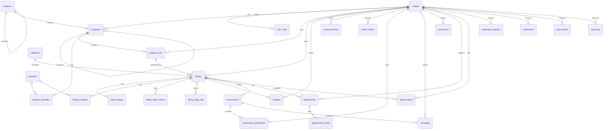

# Database Schema

แหล่งข้อมูลจริงคือ [supabase/migrations](../supabase/migrations) ทุกตารางเปิด RLS มี Test ยืนยัน และทุก Foreign Key มี Index

## ER Diagram

## Data Dictionary

### ผู้ใช้

| ตาราง | หน้าที่ | คอลัมน์สำคัญ |
|---|---|---|
| `profiles` | ข้อมูลผู้ใช้ 1:1 กับ `auth.users` สร้างโดย Trigger | `email` (ซิงก์จาก Auth), `display_name`, `phone`, `status`, `verified_at` |
| `user_roles` | บทบาท มีได้หลายบทบาทต่อคน Client เขียนไม่ได้ | `user_id`, `role`, `granted_by` |
| `user_blocks` | การบล็อกผู้ใช้ มีผลทั้งสองทิศทาง | `blocker_id`, `blocked_id` |
| `push_tokens` | Expo Push Token ต่อเครื่อง | `token`, `user_id`, `platform` |

### ข้อมูลอ้างอิง

| ตาราง | หน้าที่ |
|---|---|
| `categories` | ประเภทอสังหาฯ Admin เพิ่มได้โดยไม่แก้โค้ด |
| `amenities` | สิ่งอำนวยความสะดวก แยก `scope` เป็น `building` และ `unit` |
| `locations` | จังหวัด เขต แขวง เป็นลำดับชั้นด้วย `parent_id` |
| `application_settings` | การตั้งค่า `is_public` กำหนดว่า Client อ่านได้หรือไม่ |
| `listing_transitions` | กฎการเปลี่ยนสถานะประกาศ ใช้โดย Trigger |

### ทรัพย์และประกาศ

| ตาราง | หน้าที่ | คอลัมน์สำคัญ |
|---|---|---|
| `properties` | โครงการ อาคาร หรือทรัพย์เดี่ยว | `kind`, `parent_id`, ที่อยู่, `lat`, `lng` (จำกัดในกรอบประเทศไทย) |
| `property_units` | ห้องจริงในโครงการ | `owner_id`, `unit_number`, `area_sqm`, `bedrooms`, `furnishing` |
| `listings` | ประกาศ ห้องเดียวมีได้ทั้งขายและเช่า | `purpose`, `status`, ราคา, `price_sort` (generated), `search_text`, `expires_at` |
| `listing_images` | รูปภาพ | `storage_path`, `thumb_path`, `sort_order`, `is_cover` |
| `listing_status_history` | ประวัติสถานะ เขียนโดย Trigger | `from_status`, `to_status`, `actor_id` |
| `listing_daily_stats` | ยอดเข้าชมรายวัน | `day`, `views` |

เงินเป็น `bigint` หน่วยบาทเต็ม ส่วนพื้นที่เป็น `numeric(8,2)`

### การใช้งานของสมาชิก

| ตาราง | หน้าที่ |
|---|---|
| `favorites` | รายการโปรด |
| `saved_searches` | เงื่อนไขค้นหาที่บันทึก เก็บเป็น `jsonb` |
| `search_history` | ประวัติการค้นหา |
| `conversations` | หนึ่งบทสนทนาต่อผู้สนใจต่อประกาศ |
| `conversation_participants` | ผู้ร่วมสนทนาและ `last_read_at` ที่ใช้ทำสถานะอ่านแล้ว |
| `messages` | ข้อความ แก้ไขหรือลบไม่ได้ |
| `appointments` | นัดหมาย `proposed_at` เก็บเวลาที่กำลังเจรจา |
| `appointment_events` | ประวัตินัดหมาย เขียนโดย Trigger |

### ความปลอดภัยและระบบ

| ตาราง | หน้าที่ |
|---|---|
| `listing_reports` | รายงานประกาศหรือผู้ใช้ |
| `verification_requests` | คำขอยืนยันตัวตน เอกสารอยู่ใน Private Bucket |
| `notifications` | การแจ้งเตือนในแอป |
| `audit_logs` | บันทึกการกระทำสำคัญ แก้ไขหรือลบไม่ได้แม้แต่ Service Role |
| `rate_limits` | ตัวนับ Rate Limit แบบ Fixed Window |

## กฎที่บังคับในฐานข้อมูล

| กฎ | กลไก |
|---|---|
| ประกาศขายต้องไม่มีราคาเช่า และกลับกัน | `listings_price_matches_purpose` |
| หนึ่งห้องมีประกาศที่ใช้งานได้หนึ่งรายการต่อวัตถุประสงค์ | `listings_one_active_per_unit_key` |
| ผู้ประกาศใช้ชื่อซ้ำในประกาศที่ใช้งานอยู่ไม่ได้ | `listings_no_duplicate_title_key` |
| เปลี่ยนสถานะได้ตามกฎเท่านั้น | Trigger `guard_listing_write` |
| Client แก้ฟิลด์การตรวจสอบไม่ได้ | Trigger `guard_listing_write`, `guard_profile_update` |
| หนึ่งนัดที่ยังใช้งานต่อผู้ขอต่อประกาศ | `appointments_one_active_key` |
| Audit Log แก้ไขไม่ได้ | Trigger `forbid_mutation` |

## Delete Behavior

- `listings` ไม่ถูกลบจริง ใช้สถานะ `archived`
- ปิดบัญชีเป็น Soft Delete ลบข้อมูลส่วนตัวแต่เก็บแถวไว้ เพราะบทสนทนาของคนอื่นยังอ้างอิงอยู่
- ตารางลูกที่ไม่มีความหมายถ้าไม่มีแม่ใช้ `on delete cascade` ส่วนการอ้างอิงผู้ตรวจสอบใช้ `set null` และการอ้างอิงเจ้าของใช้ `restrict`

## Storage

| Bucket | Public | เก็บอะไร |
|---|---|---|
| `avatars` | ใช่ | รูปโปรไฟล์ |
| `listing-media` | ใช่ | รูปประกาศ |
| `verification-docs` | ไม่ | เอกสารยืนยันตัวตน เข้าถึงผ่าน Signed URL อายุ 5 นาที |

Client เขียน Storage ตรงไม่ได้ ทุกไฟล์ผ่าน API
